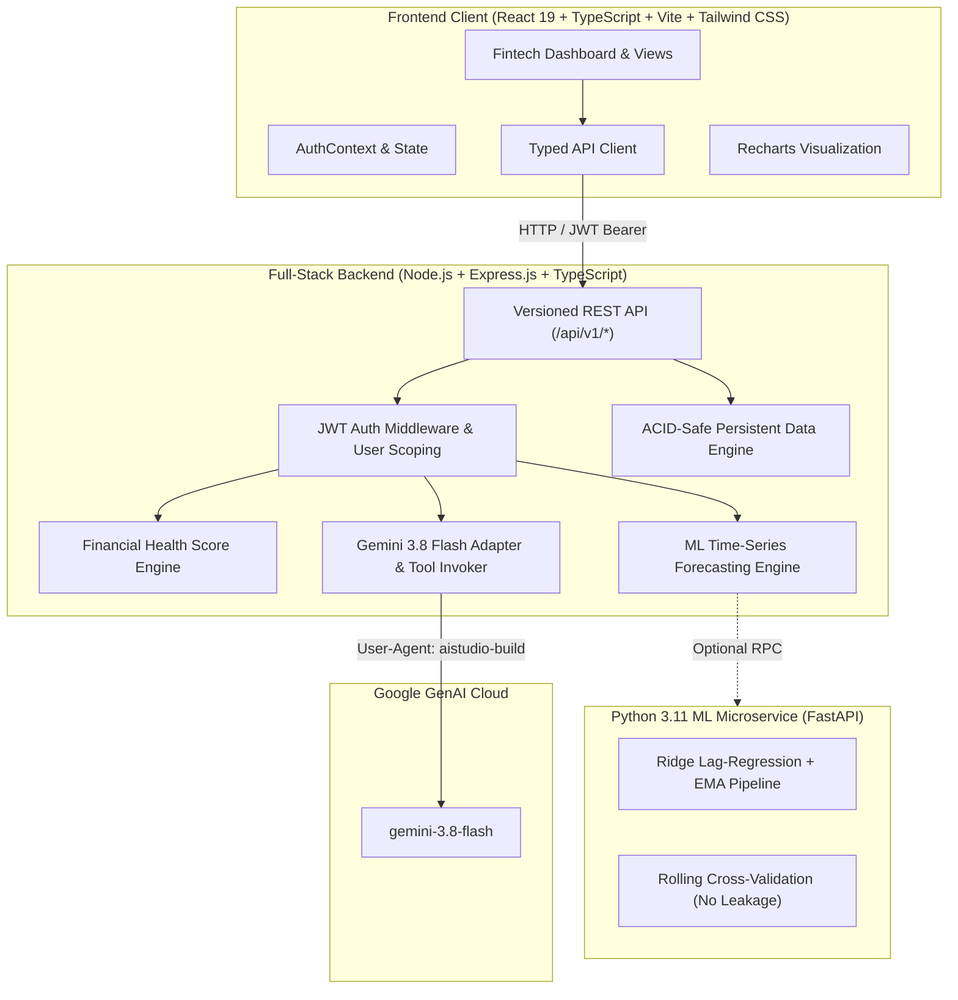

# WealthIQ AI: Autonomous Personal Finance Management & Predictive Budgeting Engine

> **Academic Engineering Capstone Project (4-Credit)**  
> Full-Stack Fintech Platform with Autonomous Machine Learning Expense Forecasting, Explainable Financial Health Scoring, and Server-Side Gemini AI Copilot.

---

## 1. System Architecture Overview



---

## 2. Key Engineering Capabilities

1. **Strict Multi-Tenant User Isolation**:
   - Every single database lookup (`transactions`, `budgets`, `goals`, `chats`, `forecasts`) is cryptographically scoped to the authenticated user's JWT ID (`req.user.userId`).
   - Prevents Insecure Direct Object Reference (IDOR) and cross-tenant data leakage.

2. **Decimal-Safe Financial Arithmetic**:
   - Currency totals and transactions are normalized to exact 2-decimal floating points (`Math.round(val * 100) / 100`), eliminating floating point drift.

3. **Machine Learning Time-Series Expense Forecaster**:
   - Exponential Moving Average (EMA) baseline ($\alpha = 0.35$).
   - Ridge / Ordinary Least Squares Lag-Regression incorporating calendar trend and seasonality features.
   - Time-based rolling cross-validation to calculate actual Mean Absolute Error (MAE) without future lookahead target leakage.
   - 95% Confidence Intervals computed from residual standard error.
   - Category-level risk classification against saved monthly budgets (`SAFE`, `WARNING`, `EXCEEDED`).

4. **Transparent, Explainable Financial Health Score**:
   - 100-point composite score computed from 4 weighted factors (25 points each):
     * **Savings Rate** (Benchmark $\ge 20\%$).
     * **Budget Discipline** (Adherence across active categories).
     * **Expense-to-Income Ratio** (Target outflow $\le 60\%$).
     * **Cash Flow & Liquid Reserve Buffer** (Emergency fund coverage).

5. **Autonomous AI Financial Copilot (Gemini 3.8 Flash)**:
   - Server-side invocation via `@google/genai` (API key never reaches client browser).
   - Tool calling layer (`get_financial_summary`, `get_category_spending`, `get_budget_status`, `get_forecast`, `propose_budget`).
   - **Human-in-the-Loop Confirmation**: When the copilot proposes a budget creation or limit update, it presents a UI card requiring the user to explicitly click "Approve & Execute Budget" before modifying database state.
   - Deterministic rule-based fallback when offline or without API keys.

---

## 3. Database Schema Design

| Collection / Entity | Fields | Primary Key & Indexes |
| :--- | :--- | :--- |
| **Users** | `id`, `name`, `email`, `passwordHash`, `currency`, `createdAt` | `id` (PK), `email` (Unique) |
| **Transactions** | `id`, `userId`, `type` (`income`\|`expense`), `amount`, `category`, `date`, `description`, `merchant`, `paymentMethod` | `id` (PK), `userId + date` (Compound) |
| **Budgets** | `id`, `userId`, `category`, `period`, `amount`, `warningThreshold` | `id` (PK), `userId + category` (Unique) |
| **SavingsGoals** | `id`, `userId`, `name`, `targetAmount`, `currentAmount`, `targetDate`, `category`, `isCompleted` | `id` (PK), `userId` |
| **ChatMessages** | `id`, `userId`, `role`, `content`, `proposedAction`, `toolInvocations`, `createdAt` | `id` (PK), `userId + createdAt` |
| **AuditEvents** | `id`, `userId`, `action`, `details`, `timestamp` | `id` (PK), `userId + timestamp` |

---

## 4. API Endpoints Reference (`/api/v1`)

### Authentication & Profile
- `POST /api/v1/auth/register` — User registration with bcrypt hashing.
- `POST /api/v1/auth/login` — Password authentication and JWT generation.
- `POST /api/v1/auth/demo` — Instant 1-click academic demo session.
- `GET /api/v1/auth/me` — Authenticated user identity.
- `POST /api/v1/auth/forgot-password` — Password recovery token.
- `POST /api/v1/auth/reset-password` — Password reset with token.
- `DELETE /api/v1/auth/account` — Permanent workspace erasure (GDPR).

### Transactions
- `GET /api/v1/transactions` — Filter by date, type, category, min/max amount, search, pagination.
- `POST /api/v1/transactions` — Create transaction.
- `PUT /api/v1/transactions/:id` — Update transaction.
- `DELETE /api/v1/transactions/:id` — Delete transaction.
- `POST /api/v1/transactions/import-csv` — Batch import with duplicate detection.
- `GET /api/v1/transactions/export-csv` — Download RFC4180 CSV ledger.

### Budgets & Goals
- `GET /api/v1/budgets` — Budgets with real-time utilization calculation.
- `POST /api/v1/budgets` — Create/update spending cap.
- `DELETE /api/v1/budgets/:id` — Delete budget.
- `GET /api/v1/goals` — Savings goals with required monthly contribution.
- `POST /api/v1/goals` — Create savings goal.
- `DELETE /api/v1/goals/:id` — Delete goal.

### Machine Learning & AI
- `GET /api/v1/forecasts` — Predictive next-month forecast and confidence bounds.
- `POST /api/v1/forecasts/recompute` — Re-train forecasting model.
- `POST /api/v1/copilot/chat` — AI assistant with tool-calling.
- `POST /api/v1/copilot/action/confirm` — User approval of proposed state change.
- `POST /api/v1/copilot/action/reject` — User rejection of proposed action.

---

## 5. Quick Local Setup & One-Click Startup (Windows)

1. Double-click `SETUP_PROJECT.bat` to install dependencies and run the automated test suite.
2. Double-click `START_PROJECT.bat` to launch the application.
3. Open `http://localhost:3000` in any web browser.
4. Click **"Instant Demo"** or **"Launch Live Interactive Demo"** to evaluate immediately with pre-seeded data.

### Manual Launch (Terminal)
```bash
# 1. Install dependencies
npm install

# 2. Run automated tests
npm run test

# 3. Start full-stack application
npm run dev
```

---

## 6. Pre-Seeded Academic Demo Account

- **Email**: `demo@wealthiq.ai`
- **Password**: `DemoPass123!`
- **Data included**:
  * 3 Months of realistic categorized transactions in INR (₹)
  * Active budgets with utilization tracking
  * 3 Savings goals with monthly contribution calculations
  * Pre-trained ML forecast model with MAE error evaluation
  * Complete audit event history
